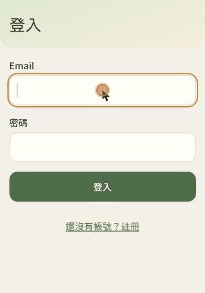

# 補對了嗎？（nutrition-agent）

[](https://github.com/polun1210/nutrition-agent/actions/workflows/ci.yml)

拍下保健食品標示與藥袋，系統判斷**多罐加總是否超過上限**、**是否和正在吃的藥有交互作用**，並產出每句都附引用來源、可以列印給醫師看的報告。

這是個人作品集專案：以自己的方式，從頭重新實作舊團隊專案「補對了嗎？」。整個 repo 由我一人完成。

<p align="center">
  
</p>

## 問題與目標使用者

慢性病患者常同時吃好幾罐保健食品，卻很少有人會把每罐的成分加總起來，再對照正在吃的藥：

- **多罐加總超過上限**：綜合維他命、鈣片、魚油各自看都沒事，加起來可能超過每日上限攝取量（UL）。
- **和用藥交互作用**：例如吃 ARB 類降血壓藥時再補充鉀，可能造成高血鉀。

目標使用者是吃慢性病用藥的長輩與照顧家人的子女。所以介面手機優先，用拍照取代打字；報告用白話寫，也能直接列印帶去看診。

範圍刻意收窄：5 種慢性病（高血壓、第二型糖尿病、高血脂、慢性關節炎、慢性失眠症）的常見用藥類別，以及 13 項營養素。範圍外的成分在報告裡如實列出，不假裝評估過。

## 架構

```
標示照片 ─VLM─► 成分＋劑量 ─┐
藥袋照片 ─VLM─► 藥名 ─► TFDA 藥名表 ─► 有效成分
                            ├─► assessment（確定性判定：上限比對、交互作用規則）
用藥／個人資料 ─────────────┘          │
                                       ▼
                      retrieval（RAG 檢索 NIH ODS、NCCIH、DRIs）
                                       │
                                       ▼
                      reporting（LLM 只解釋判定，每句附引用）
```

FastAPI＋PostgreSQL／pgvector＋React（Vite），照片存在 S3 相容的物件儲存，全部以 Docker Compose 啟動（[ADR-0002](docs/adr/0002-fastapi-react-postgres-pgvector.md)）。模型透過 OpenRouter 呼叫。

## 設計亮點

### 1. 判定交給程式，LLM 只負責解釋

是否超過上限、命中哪條交互作用規則，全部由規則表與 DRIs 計算產生，同一份輸入永遠得到同一個結論。LLM 只把已經產生的判定翻成白話，而且要遵守三條限制：

- 每句都要附上檢索到的證據編號。
- 不得出現任何數字。報告裡的數值一律由模板從判定直接渲染。
- 不得出現建議劑量、停藥這類禁用說法。

這些限制由程式檢查，不合格就重試，仍不合格就退回已審定的固定說明。→ [ADR-0001](docs/adr/0001-rag-explains-findings-only.md)

### 2. 規則的出處引文，必須逐字出現在語料裡

每條交互作用規則都要附上 NIH ODS 或 NCCIH 的原文引文。測試會逐字比對 `knowledge/` 裡的語料，找不到就失敗。規則可以由 LLM 協助草擬，但只有人能標成「審定」，目前共審定 10 條。這取代了舊專案的雙人覆核，規則和 RAG 也共用同一套證據。→ [ADR-0001](docs/adr/0001-rag-explains-findings-only.md)、`tests/reference/test_rules.py`

### 3. 用 eval 選模型，不憑印象

我用實拍的保健食品照片（19 張）和藥袋照片（32 張）比較了四個 VLM：

| 模型 | 結果 |
|---|---|
| claude-haiku-5.5 | 含量全對 73/75，51 張共 $0.03 |
| claude-sonnet-5.5 | 貴 20 倍，沒有比較準 |
| gemini-3.8-flash | 最慢單張要 142 秒，超過等待門檻 |

評估時另外加了「產品層級」指標：每份量讀錯一次，整瓶的每個成分都會錯好幾倍，只看單列的正確率會高估實際表現。結構化輸出（structured outputs）也是用 eval 決定的：藥包和解釋採用；標示讀取用了之後召回率反而下降，所以不採用。→ [ADR-0004](docs/adr/0004-llm-claude-haiku-5-5.md)、[ADR-0005](docs/adr/0005-vlm-claude-haiku-5-5.md)

### 4. 照片先正規化，再辨識與存檔

照片依 EXIF 轉正、長邊縮到 1600 px、重新編碼成 JPEG，並去掉 GPS 等中繼資料。VLM 看到的，和物件儲存存下來的是同一張，回頭查「為什麼讀錯」時才準確。→ [ADR-0007](docs/adr/0007-photo-normalization.md)

### 5. presigned URL 綁定 host，過期照片由程式清理

- **讀取照片**：API 先確認照片屬於登入者本人，再 302 導向短效的 presigned URL，由瀏覽器直接向物件儲存取圖。SigV4 的簽章綁定 host，所以內部讀寫和對外簽章分成兩個 endpoint 設定（實測換 host 會得到 403）。
- **刪除過期照片**：不用 bucket lifecycle，而是用程式清理：先刪物件，再在資料庫標記，可以安全地重複執行。→ [ADR-0006](docs/adr/0006-object-storage-seaweedfs.md)、[照片維運](docs/photo-operations.md)

### 6. 量測解釋的忠實度

輸出檢查用的禁用詞黑名單擋得住關鍵字，擋不住換句話說。所以我另外寫了一組對抗句，再找一個不同的模型當評審，逐句檢查解釋是否被引用的段落支持：

- **對抗句**：應攔下的 10 句裡，黑名單只擋下 1 句，評審 10 句全部攔下。
- **真實解釋**：只有 50% 的句子被證據支持，主因是 LLM 複述判定、自行加上就醫建議。這個量化結果是下一步調整 prompt 的依據。

評審只用在 eval，不放進正式流程。→ [evals/README.md](evals/README.md)

### 測試

pytest 共 680 個測試，搭配 Playwright E2E。測試用 moto 模擬 S3、用假的模型閘道，不打外部 API。打真模型的評估放在 `evals/`，與測試分開。

## 已知限制與刻意不做的事

這是作品集，不正式上線。下面這些是刻意留下的缺口，每項都附上上線前要補什麼：

| 項目 | 現況與原因 | 上線前要補 |
|---|---|---|
| 個資同意、刪除帳號與匯出 | 沒有真實使用者，所以沒做同意流程 | 同意書、刪除帳號（連同照片物件）、資料匯出 |
| 登入限流 | 登入和註冊沒有次數限制 | 依 IP 和帳號限流、連續失敗鎖定 |
| 藥袋照片本身印有姓名與醫院 | 正規化只去掉中繼資料，畫面內容照存 | 上傳前提醒使用者裁切，或改成只保存辨識結果 |
| 資料庫連線池 | 每個請求新建一條連線，作品集的量用不到連線池 | 改用 `psycopg_pool` |
| 送出流程是同步的 | 送出時當場產生解釋，請求要掛著等 10–30 秒 | 改成背景工作佇列，前端輪詢或用 SSE 接收 |
| 雲端部署 | 只有本機 Compose 和正式版演練 | 代管資料庫與物件儲存、密鑰管理、HTTPS |
| 孤兒草稿不清理 | 開始評估就會建立草稿，沒送出的會一直留著 | 排程清理過期草稿與對應的照片 |
| 藥袋辨識偶爾讀不到 | 同一張照片約四次會有一次回傳空結果，只能請使用者重拍 | 失敗時自動重試一次 |

## 未來可能的擴充

- **報告頁的問答機器人**：使用者可以追問「為什麼鉀要注意？」。它沿用同一套檢索與引文檢查，只解釋已經產生的判定，不做新的判定。
- **給藥師看的一頁式摘要**：只列出用藥、保健食品成分和需要討論的項目。
- **範圍外的用藥類別**：例如抗凝血藥（warfarin）、甲狀腺素。這類藥的交互作用多半需要錯開服用的時數，要先補齊可引用的語料。

## 開發與測試

```
cp .env.example .env        # 填入 OpenRouter 金鑰與模型 ID（不填也能跑骨架）
docker compose up --build   # db（pgvector）+ seaweedfs（S3 :8333）+ api :8000 + web :5173
```

開啟 http://127.0.0.1:5173 。開發時在另一個終端機執行 `docker compose watch`：修改 `src/` 會同步並重啟 API，修改 `web/src/` 由 Vite 熱更新。

測試與檢查（需要 `docker compose up -d db`，會自動重建 `nutrition_test` 資料庫，不碰開發資料）：

```
uv run pytest
uv run ruff check
cd web && npm run build          # 前端型別檢查＋打包
cd web && npx playwright test    # E2E
```

<details>
<summary>其他：正式版演練、只用容器跑資料庫、migration</summary>

在本機演練前端正式版（需要 Docker Compose 2.24.4 以上）：

```
docker compose -f compose.yaml -f compose.prod.yaml up --build
```

開啟 http://127.0.0.1:8080 。正式版以 nginx 提供前端靜態檔案，並把 `/api/` 反向代理到 API。這只是本機演練，後端環境變數沿用開發堆疊。API 容器以非 root 使用者 `app` 執行，健康檢查端點是 `GET /api/health`。

只跑資料庫與物件儲存、其餘在本機：

```
docker compose up -d db seaweedfs
uv sync
uv run alembic upgrade head
uv run uvicorn nutrition_agent.api.app:app --reload
cd web && npm install && npm run dev
```

新增 migration：在 `migrations/versions/` 加一個檔案（revision 依序編號）。照片清理排程見 [照片維運](docs/photo-operations.md)。

</details>

| 目錄 | 用途 |
|---|---|
| `src/nutrition_agent/` | `extraction`（VLM）、`assessment`（判定）、`retrieval`（RAG）、`reporting`（報告）、`api` |
| `knowledge/` | RAG 語料，見 `knowledge/README.md` |
| `evals/` | VLM、藥包、RAG 與忠實度的評估 |
| `web/` | 前端（React＋Vite＋TypeScript，手機優先） |
| `docs/adr/` | 決策紀錄 |
| `docs/legacy/` | 舊團隊專案的文件，只供參考 |

## 致謝

本 repo 由我一人，以自己的方式從頭重新實作 AIPE04 期末專題的舊團隊專案「補對了嗎？」；舊專案的文件只放在 `docs/legacy/` 供參考。VLM 標註資料、TFDA 仿單整理、NIH ODS 與 NCCIH 語料都由我本人整理。資料來源：TFDA 藥品開放資料、NIH Office of Dietary Supplements、NCCIH、衛福部《國人膳食營養素參考攝取量》第八版。
